Assignment 6 

Aruzhan Abdrakhmanova IT-2501 

Site: https://arabdrakh.github.io/front6/

Task 0. Setup
Included jQuery from CDN, wrote a $(document).ready() function, and tested by logging "jQuery is ready!" in the console.

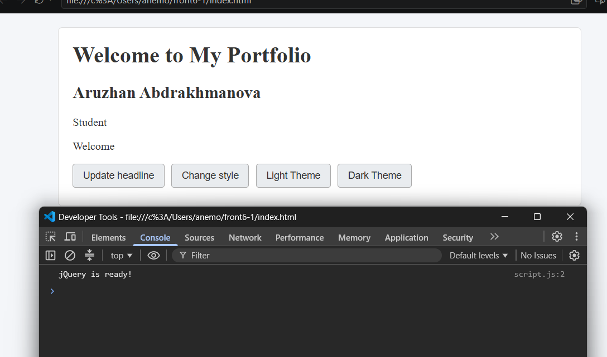

Task 1. Selectors & CSS
Created a profile section with my name, headline, and intro. Selected elements using tag, ID, and class selectors, updated headline dynamically using .text() and .html(), applied styles with .css(), and added theme switch buttons.

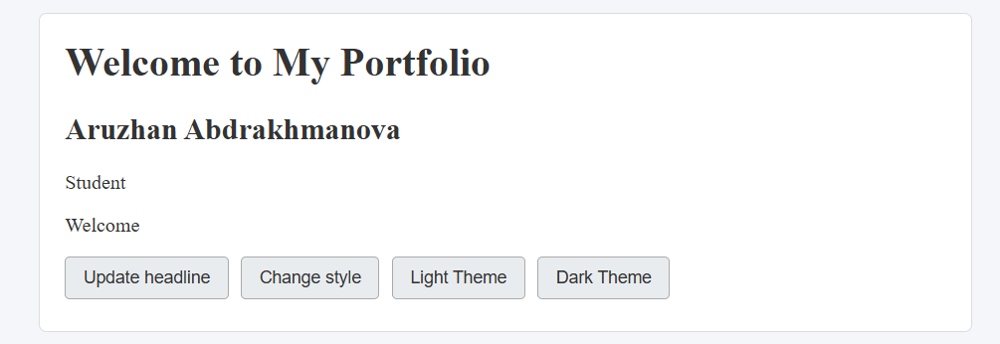

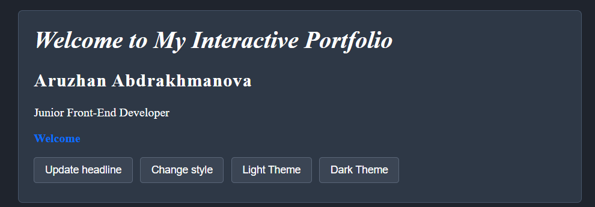

Task 2. Visibility Methods
Created an "About Me" section with bio, status message, and fun facts. Added Hide, Show, and Toggle buttons to control visibility using .hide(), .show(), and .toggle().

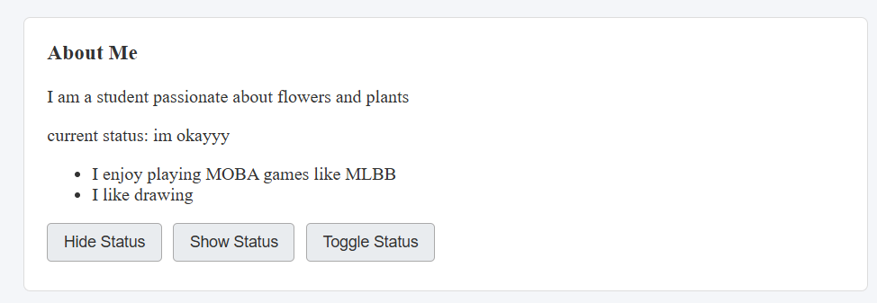

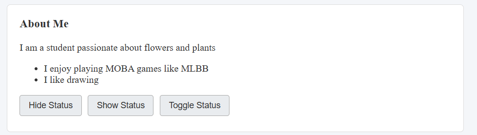

Task 3. Fade Methods
Created an image gallery featuring profile, hobby, and travel photos. Added Fade In, Fade Out, and Fade Toggle buttons using .fadeIn(), .fadeOut(), and .fadeToggle().

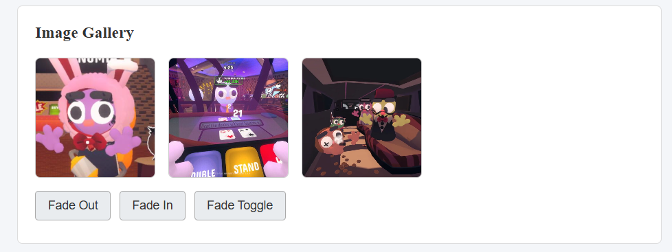

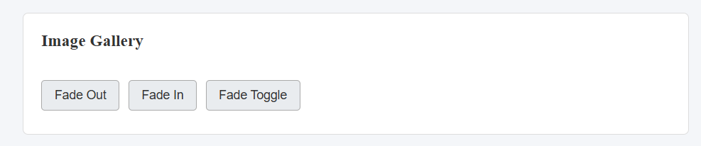

Task 4. Slide Methods
Created collapsible panels under clickable headings. Implemented smooth slide effects using .slideToggle() on heading click, and control buttons using .slideUp(), .slideDown(), and .slideToggle().

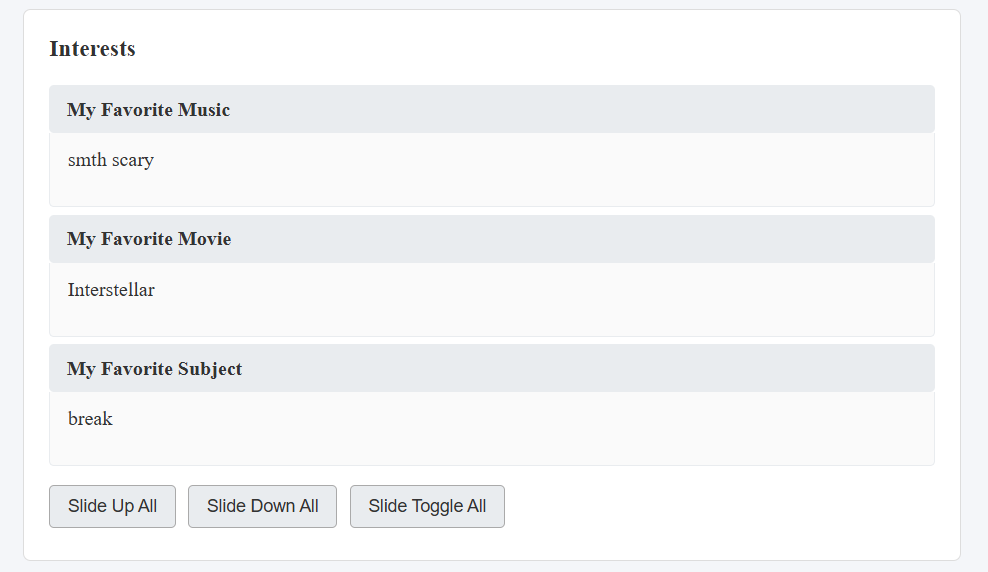

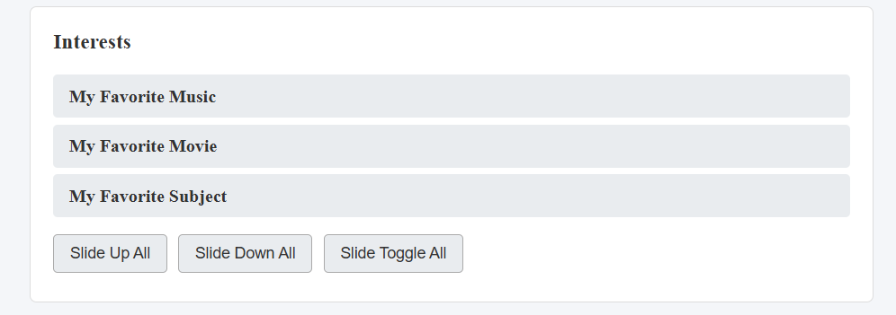

Task 5. Add & Remove Elements
Created an initial list with an input field to enter new items with validation against empty input. Implemented "Add" (.append()), "Prepend" (.prepend()), and "Remove" (.remove()) buttons.

Task 6. Modifying Attributes
Added an external link and a button that dynamically updates the link destination and text using .attr().
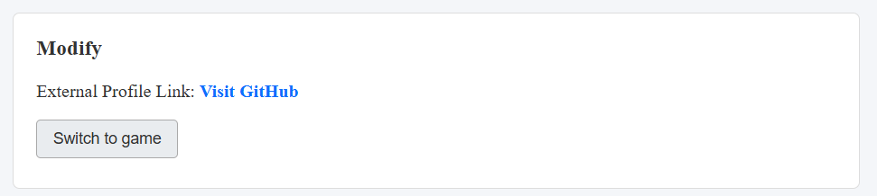

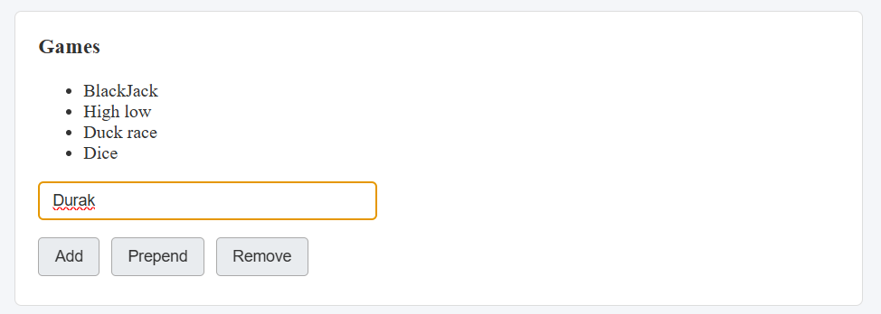

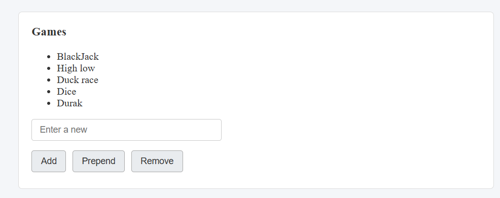

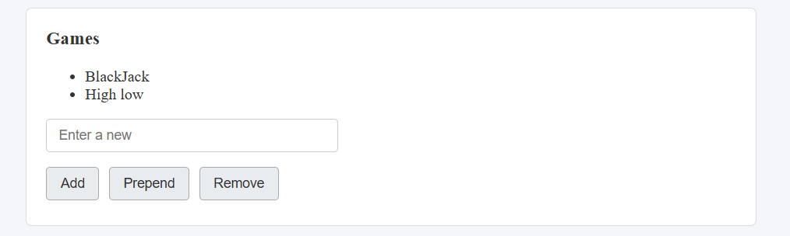

Task 7. Form Interaction
Created a form with Name and Email inputs. Added live feedback below the form displaying typed input in real time using .val() and .text().

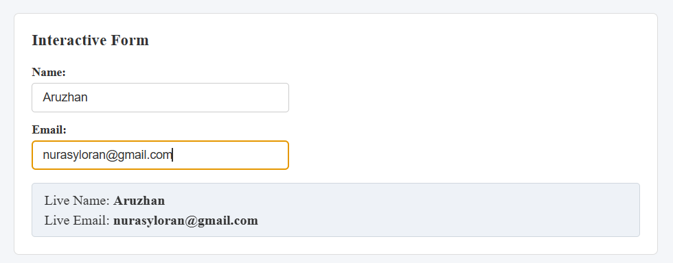

Task 8. Basic Animation
Created visual progress bars initially set to 0% width. Added an "Animate" button using jQuery .animate() to expand bars to different percentages and smoothly animate them back to 0% on subsequent click.

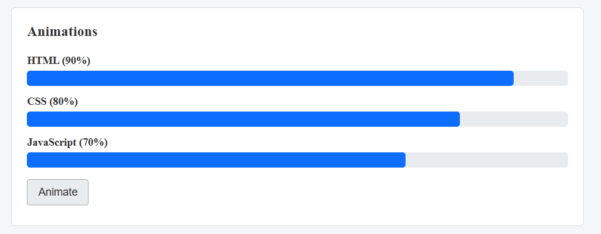

