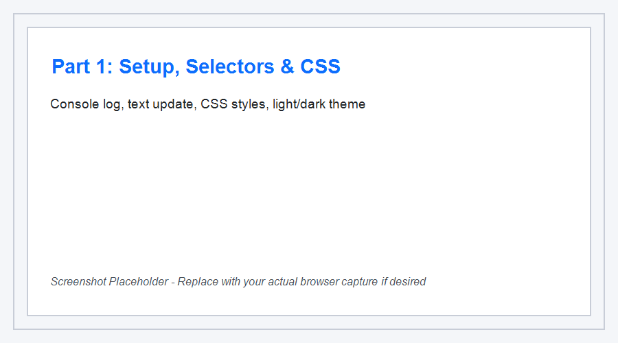
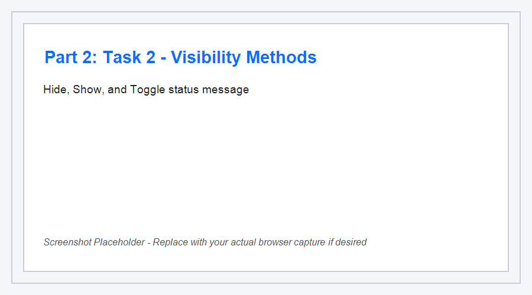
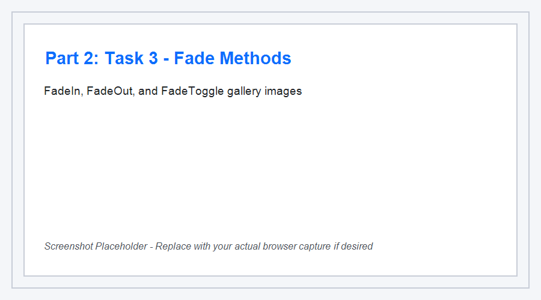
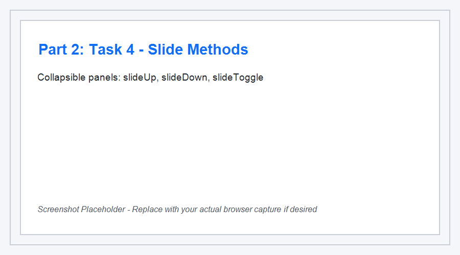
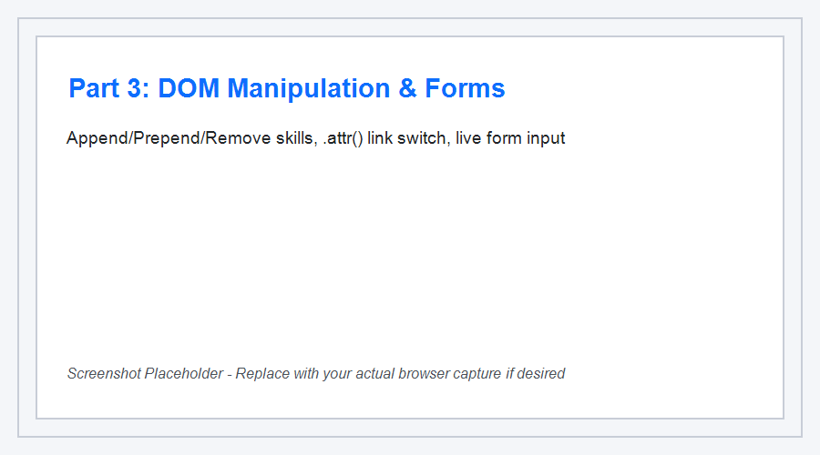
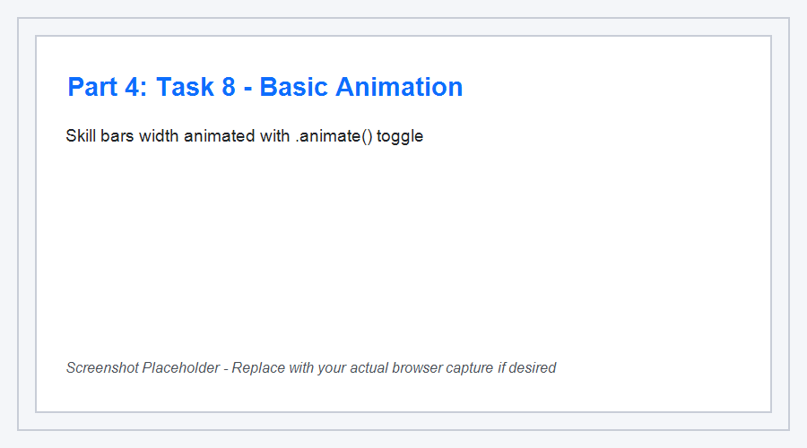

# Assignment #6: jQuery (Selectors, Effects, Animations)

- **Name:** Aruzhan Abdrakhmanova
- **Group:** [Your Group]
- **Repository:** https://github.com/arabdrakh/front6-1
- **GitHub Pages:** https://arabdrakh.github.io/front6-1/

---

## Part 1. Getting Started with jQuery

### Task 0. Setup
- Connected jQuery 3.7.1 via official CDN.
- Created `$(document).ready()` handler inside `script.js`.
- Verified execution by outputting `"jQuery is ready!"` to the browser console.

### Task 1. Selectors & CSS
- Added portfolio profile section displaying author name, headline, and an introductory text.
- Used tag (`h1`, `h2`), ID (`#headline`, `#portfolio-title`), and class (`.intro`) selectors.
- Updated headline dynamically via `.text()` and `.html()`.
- Modified CSS properties directly using `.css()`.
- Implemented light and dark theme switching using jQuery `.css()` styling.

---

## Part 2. jQuery Effects

### Task 2. Visibility Methods
- Created an "About Me" section containing biography, personal fun facts, and current status message.
- Implemented three control buttons: **Hide**, **Show**, and **Toggle** using `.hide()`, `.show()`, and `.toggle()`.

### Task 3. Fade Methods
- Created an image gallery featuring uploaded images: profile picture, hobby, and travel photos.
- Implemented **Fade In**, **Fade Out**, and **Fade Toggle** buttons using `.fadeIn()`, `.fadeOut()`, and `.fadeToggle()`.

### Task 4. Slide Methods
- Built collapsible panels under three headings: "My Favorite Music", "My Favorite Movie", and "My Favorite Subject".
- Enabled interactive smooth opening/closing using `.slideToggle()` upon heading click.
- Provided global control buttons applying `.slideUp()`, `.slideDown()`, and `.slideToggle()`.

---

## Part 3. DOM Manipulation with jQuery

### Task 5. Add & Remove Elements
- Created an initial list of technical skills (HTML5, CSS3, JavaScript, Git & GitHub).
- Added an input field with validation to prevent adding empty values.
- Implemented **Add Skill** (`.append()`), **Prepend Skill** (`.prepend()`), and **Remove Skill** (`.remove()`).

### Task 6. Modifying Attributes
- Included an external profile link pointing to GitHub.
- Created a toggle button that modifies the destination `href` and text using `.attr()`.

### Task 7. Form Interaction
- Created an interactive contact form with Name and Email input fields.
- Implemented live feedback display below the form using `.val()` and `.text()` responding to `input` events.

---

## Part 4. Animations

### Task 8. Basic Animation
- Extended technical skills representation with visual progress skill bars for HTML, CSS, and JavaScript.
- Initial width of all skill bars is set to `0%`.
- Clicking **Animate My Skills** animates bars to target widths (90%, 80%, 70%) using jQuery `.animate()`.
- Clicking the button again smoothly animates bars back to `0%` width.

---

## Summary of Work Process

1. **Project Architecture**: Set up a clean file structure with `index.html`, `style.css`, and `script.js`.
2. **jQuery Integration**: Loaded jQuery via CDN and verified readiness via `$(document).ready()`.
3. **DOM & Styling**: Applied jQuery selectors (tag, ID, class) to modify content and dynamic inline CSS for styling and theme toggle.
4. **Visual Effects**: Built interactive controls utilizing visibility methods (`hide`, `show`, `toggle`), fading effects (`fadeIn`, `fadeOut`, `fadeToggle`), and sliding accordions (`slideUp`, `slideDown`, `slideToggle`).
5. **DOM Manipulation & Form**: Handled dynamic DOM element additions, deletions with validation, attribute changes using `.attr()`, and real-time form two-way reflection.
6. **Custom Animations**: Implemented bidirectional animations with `.animate()` to visualize skill proficiencies.
